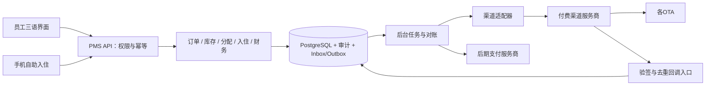

# 系统架构与分阶段实施

状态：拟议方案；本轮仅设计，不安装运行时、不创建云资源、不部署。

## 边界与技术选择

采用独立PMS模块化单体，初期避免微服务运维负担。建议TypeScript前后端、React管理界面、Node.js服务、PostgreSQL数据库；具体框架在首期实现时根据部署约束确认。数据库事务负责库存与审计，后台worker处理渠道、支付回调和异步任务。初期outbox队列保存在PostgreSQL，无需额外消息中间件。

源码后续放pms/，设计位于docs/pms/。PMS使用独立数据库、凭据和测试端口，不复用官网localStorage、询价数据或生产站点目录。官网、餐饮、供应链维持现状；未来官网预订入口是独立决策。

## 服务端契约

门店范围由已认证用户权限决定，不能信任前端property_id。建议初期角色：组织管理员、店长、前台、清洁、财务、只读；权限细化到退款、维修停用、导出、查看证件和管理用户。清洁人员只看任务所需资料。所有写入经服务端校验；高风险动作保存原因。登录采用安全会话cookie、CSRF保护、速率限制；不把访问令牌放官网购物车存储。

建议命令接口：创建/确认订单、修改住宿区间、分配、换床、逐人入住退房、设置停用、完成清洁。接口使用幂等键及expected_version；并发冲突返回409及最新状态。查询接口独立展示房态、未分配需求、余额和冲突，不接受客户端计算后的“剩余库存”。

审计包含操作者、门店、动作、对象、脱敏前后差异、原因、请求ID和UTC时间；与业务写入同事务提交。普通角色不可修改审计。证件材料另存私有加密对象存储、短时授权访问、独立访问审计与可配置保留期限；不进入普通事件payload或渠道日志。保留期、登记字段和法律要求在上线前核定。

自助入住链接保存令牌哈希、有效期、订单作用域、撤销状态和提交次数限制；手机号/链接不能成为全订单查询接口。资料提交、员工批准、正式入住分为不同状态。首期不接门锁；发送消息不是默认开发动作。

## 渠道适配边界

PMS拥有物理资源、分配、清洁与本地库存真相。渠道服务商拥有OTA传输及渠道特有规则。映射键包含provider/property/channel/room_type/rate_plan；OTA卖床型数量时不暴露内部床号。男女产品与整房/床产品只有通过服务商及OTA能力测试后才启用。

统一适配接口建议：capabilities、fetchMappings、fetchReservations(cursor)、applyAvailability(snapshot, revision)、applyRates、acknowledgeEvent、exportData。订单创建/修改/取消的出站接口只有服务商明确授权且对应OTA支持时开放，不能假设“有API”即能双向改所有订单。内部订单与渠道订单以(provider, property, external_reservation_id)唯一绑定。

入站：验签/鉴权 → 持久化Inbox并去重 → 尽快确认接收 → 异步按订单版本处理。支持重复、乱序和缺失回调；没有可靠版本号时读取服务商当前快照后应用。处理失败保留重试状态，不能先确认后丢数据。日志隐藏身份及支付敏感信息。

出站：本地事务写Outbox → worker发送库存快照 → 记录回执/版本。按门店和映射序列化库存更新；过时revision不得覆盖较新库存。超时后重试必须使用服务商幂等机制或先查询确认，不能重复创建订单。指数退避加抖动、限流、死信队列及人工重放均需可观察。

断线恢复：保存最后成功游标 → 重叠窗口补拉新建/修改/取消 → 幂等应用 → 重算库存快照 → 对账渠道回执。定期全量/分段对账补偿游标缺口。展示最后成功同步时间、未处理订单、失败库存推送和人工处理入口。恢复后不得把旧快照再次发往渠道。渠道离线不能保证绝不超卖；可配置安全余量及超时停售策略，阈值需业务确认。

导出应由PMS自己提供CSV/JSON及数据库备份，含门店、房床、订单、分配历史、财务、外部ID映射；敏感字段按权限过滤，CSV防公式注入。服务商退出时另需合同保证其数据及映射可导出。提供恢复演练而非只确认备份文件存在。

NoBeds、Beds24、Channex均为待调查候选，未选定、未取得正式报价或API许可；公开宣传及交接材料不足以确定采购。比较证据清单见requirements.md。

## 分阶段与验收门槛

| 阶段 | 交付 | 必须验证 |
| --- | --- | --- |
| 0：本轮 | 恢复源码、需求、库存、架构与决策清单 | 不覆盖已有改动；全部恢复文件与ZIP一致；不触及线上 |
| 1：库存基础 | 数据迁移、合成双门店测试数据、权限、审计、房态与维修/清洁 | 数据库真实并发测试；跨店隔离；房床互斥及连续床匹配 |
| 2：前台闭环 | 订单→分房分床→换床→入住→退房；手工收款/押金记录 | 库存模型列出的场景；事务回滚、部分入住退房、三语关键流程 |
| 3：自助入住与财务 | 私有资料提交与审核、退款/押金审批、支付沙箱 | 链接越权与过期、回调重放、金额/退款约束；不发真实消息不扣真实款 |
| 4：渠道沙箱 | 选定服务商、正式契约、测试房源映射与同步 | 双向权限逐项实测、重复乱序、断线补拉、限流、对账与完整导出 |
| 5：生产准备 | 清点真实库存、迁移演练、备份恢复、监控与回退方案 | 明确唯一库存写入方；用户另行确认后才可上线 |

测试使用TEST门店、虚构客人和固定日期；测试10房＋30床只是可配置规模样例，不声明真实布局。第二测试门店用于隔离验证。首期关键验收在真实PostgreSQL事务上运行；前端单元测试不能代替库存并发验证。开发网络默认本地，不将测试服务公开给客人。

渠道切换需暂停旧系统的生产推送并完成最终对账，具体窗口另定；不得在设计或沙箱阶段修改现有渠道配置。备份恢复和回滚必须包含订单增量，不能简单还原旧数据库丢掉切换后订单。

## 连锁经营与成本原则（用户确认，2026-10-15）

用户自建PMS的主要动机是现有系统按房间/床位收费，扩容后成本持续增加，并需要自有系统支撑连锁经营。JOVIAN自有PMS不设置按门店、房间或床位数量的授权收费及软件配额；总部统一管理，员工按门店和职能授权，门店可独立设置房型、价格和政策。

固定基础预算是目标，不承诺无限规模总成本不变。服务器、备份、对象存储、维护和第三方渠道可能随负载分档；支付手续费另计。渠道采购优先固定账户费、连锁套餐或年度封顶报价，核实新增门店/房床边际费用与退出导出能力。若候选商按量收费，应明确列入扩张预算，不将其隐藏成PMS费用。

多店比较应计算当前7间计费、10间管理＋30床、未来多店三种情景，并分别列一次性研发/迁移、固定运行、按量渠道/支付和维护费用。未取得正式报价前不宣称自建一定更便宜。

## TT智能门锁方向（2026-10-15）

用户提供TTLock/TTHotel官方接口用于自助入住。已核实官方对接能力并补充docs/pms/ttlock-integration.md；现有设备型号、账号体系、数据区域、网关、价格与测试锁仍待确认。先实现模拟适配器与授权状态机，之后只读设备映射，再对独立测试锁验证。本轮未连接设备、发密码、开锁或发送消息。该计划细化此前“首期不接门锁”，不扩大生产操作授权。

## JOVIAN品牌层级

组织（Organization）→品牌（Brand）→门店（Property）。JOVIAN为商业管理体系，PMS为当前建设模块，CO-HUB为旗下青旅品牌。总部可跨品牌查看；运营权限仍按明确门店授权，不因品牌相同自动获得全部门店权限。后续增加Brand实体与Property.brand_id，品牌归属使用组织范围外键；变更品牌保留历史，不改变原订单门店、库存或财务归属。现有原型尚未实现品牌管理和权限控制。本次仅更新系统命名，不推断组织法律注册名。

## 统一系统范围确认（用户最终确认，2026-10-15）

CO-HUB青旅与JOVIAN酒店式公寓共用一套JOVIAN PMS、一套代码和统一后台，不建立独立系统或开发分支。此前将JOVIAN单纯描述为上级体系、CO-HUB描述为分支的解释不再作为业务结构依据：JOVIAN也是酒店式公寓业务名称，CO-HUB为青旅业务名称。品牌仅作门店资料与筛选维度，首期不单独建设品牌管理层。

组织→门店为核心归属；门店配置显示品牌、住宿类型与销售产品。青旅支持床位、性别分区与同房分床；公寓支持按房/整套销售及分房换房。复用订单、库存、收退款、押金、入住退房、清洁维修、自助入住、门锁和报表模块，权限按门店和职责控制。整套与子房若共享物理空间，必须沿用物理资源互斥，不能生成两份独立容量。公寓是否涉及长租、月租及账单周期尚未确认，不推定。

当前原型仍为通用合成双店测试数据，尚未代表真实CO-HUB或JOVIAN布局；本次仅澄清设计，不声称已实现公寓业务配置、共享后台或品牌筛选。

## 全部功能与扩展范围（用户确认，2026-10-15）

用户要求全部参考SmartOrder全部功能，而非只交付前台演示；同时加入财务系统、自动生成门店网页和完整自助入住。统一建设及验收清单见docs/pms/master-scope.md，模块持续随官方资料及授权后台观察补充，不假设已穷尽或实现。CO-HUB与JOVIAN公寓共用一套系统。财务中餐饮/供应链的核算范围仍待确认，住宿餐饮不挂账；不得据此修改线上餐饮、供应链或官网。当前0.3仍为本地部分流程，完整共享后台、财务、网站生成、自助入住及真实外部接入尚未交付。下一阶段优先共享服务端与权限/事务基础。
